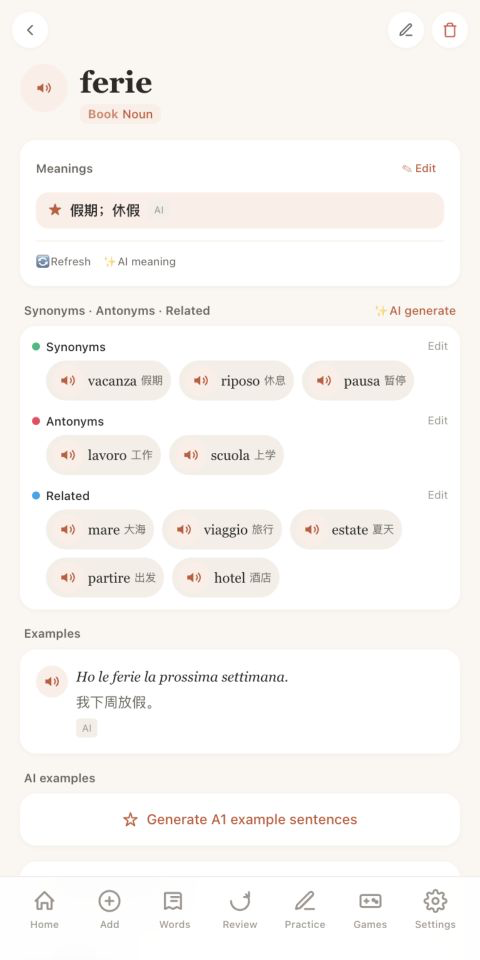
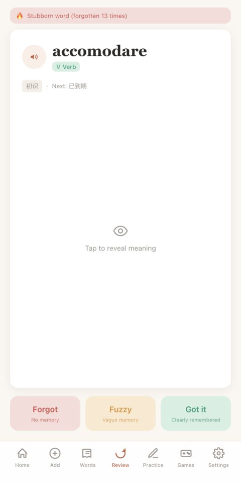
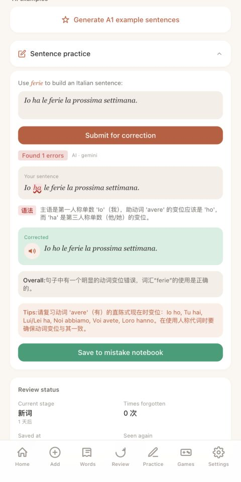
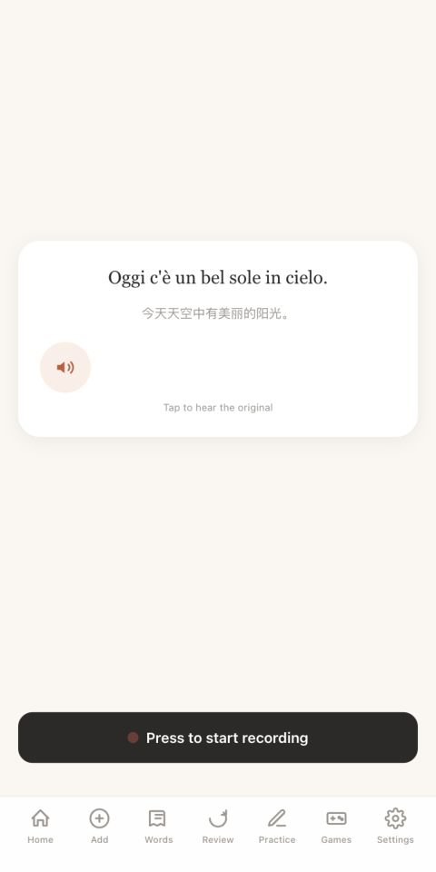

# Italian Vocabulary Learning App

A personal Italian study app, built with AI-assisted coding tools.

[**Try the demo**](https://f2bd6a26ea564308bb3f1a3f31f50704.app.codebuddy.work/?demo=1) — no sign-in or API key needed.

## Try the Demo

Select **Start the guided demo** to try word details, sentence feedback, a review card and speaking practice. After finishing, **Explore another saved AI example** opens a word-meaning example with an English summary.

The demo uses sample data and saved AI responses. It does not generate new responses. Audio uses browser text-to-speech; recording and pronunciation scoring are not part of the demo.

[Open the full app](https://3b59dfb43ad84cc18294a37d89970a7d.app.codebuddy.work/) for the other features shown below. You can browse as a guest. Live AI features may need your own supported API key in **Settings**. The screenshots show the full app with AI already configured.

## Screenshots

<table>
  <tr>
    <td align="center" width="50%">
       
      <b>Vocabulary details</b> 
      A saved meaning, related words and an example sentence.
    </td>
    <td align="center" width="50%">
       
      <b>Vocabulary review</b> 
      Recall a word and choose Forgot, Fuzzy or Got it.
    </td>
  </tr>
  <tr>
    <td align="center" width="50%">
       
      <b>AI sentence feedback</b> 
      The app flags “ha” and suggests “ho” in this sentence.
    </td>
    <td align="center" width="50%">
       
      <b>Shadowing practice</b> 
      Audio playback and recording controls for self-review.
    </td>
  </tr>
</table>

Screenshots from the [full app](https://9c590504dcf647afa1ae7ad5c12704c3.app.codebuddy.work/), taken on 5 November 2026. They show my existing study session, including saved AI responses. Some meanings and feedback are in Chinese. The guided demo uses a smaller set of sample data.

## Why I Built It

I often looked up an Italian word, understood it, and then forgot it. Sometimes I could recognise a word but could not use it in a sentence.

I built this app to keep those words together and practise them again, using review cards, sentence exercises and shadowing.

## What the App Does

- Collect words by typing, photo, voice or document import.
- Look up words and keep them in a personal wordbook.
- Review cards using Forgot, Fuzzy and Got it, with progress and review tracking.
- Add AI explanations, examples, synonyms, antonyms and related vocabulary.
- Practise with AI-generated gap-fill, collocation and scenario exercises.
- Write sentences and get AI feedback and corrections.
- Practise shadowing with sentences or dialogues, audio playback, recording and self-review.
- Use the interface in several languages, access the dictionary offline after loading, and sync learning records when signed in.

## How I Use AI

AI adds explanations and practice material around the words I save. Dictionary entries and review records are kept separately from generated content.

The demo includes two saved examples:
- A sentence correction from “Io ha le ferie la prossima settimana” to “Io ho le ferie la prossima settimana”.
- A meaning added to a *diventare* card that displayed an example sentence but no meaning.

The full app also uses AI for example sentences, related vocabulary, exercises and shadowing content. I check the suggestions before relying on them. Shadowing uses playback, recording and self-review; it does not score pronunciation.

## What I Did

I started this project for my own Italian study. I chose the features, set priorities and decided how the learning activities should fit together.

I used CodeBuddy extensively to generate and revise the code. My work included:
- writing requirements and checking the resulting app against them;
- testing word capture, review, sentence practice and shadowing;
- checking AI responses and adjusting prompts;
- identifying bugs and working through fixes;
- publishing the app and the portfolio demo.

## Development Process

I worked on one feature at a time: describe what I needed, try the implementation, find what did not work, and revise it.

One recent decision was how to let a visitor try the app without setting up an AI key. I added a short guided demo using saved responses. It shows the correction and meaning examples, labels their source, and keeps the visitor's actions separate from my study data.

## Tech Stack

- React
- Vite / PWA
- IndexedDB / Dexie
- Supabase
- Gemini API
- Groq API
- CodeBuddy for AI-assisted development

## Next Steps

- Check a sample of AI meanings against dictionary references and record errors.
- Try the app with other Italian learners and note where they get stuck.
- Use those findings to improve sentence feedback and the review flow.

## Project Status

Independent personal project · 2026–Present

This repository contains the project description and screenshots. Application source code is not included.

